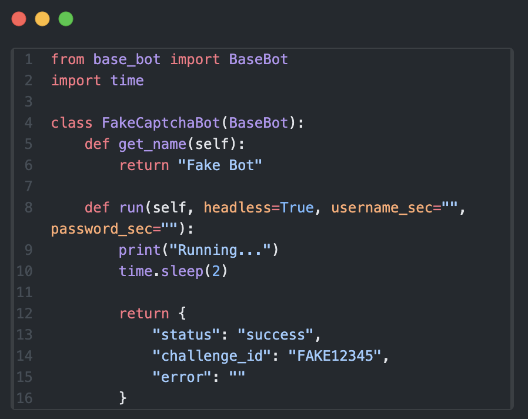
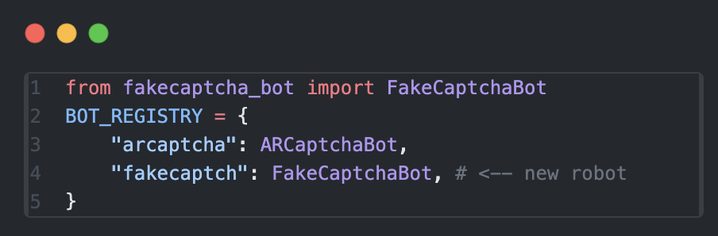
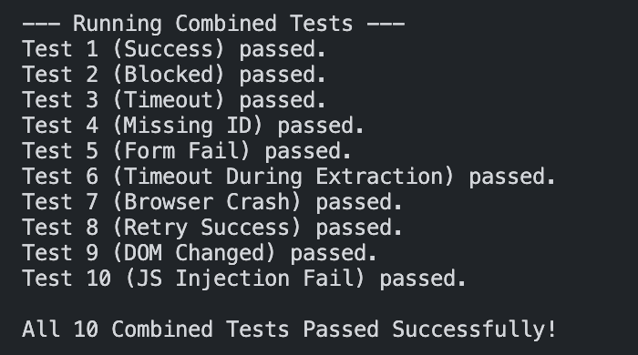

# Extensible Browser Bot Platform


## Prerequisites

- Python 3.9 or higher.
- Google Chrome browser installed.
- Docker and Docker Compose (for containerized deployment).

## Run

Follow these methods to set up and run the project:(run all the commands in the Webplatform folder)

### Install dependencies:
```bash
python -m pip install -r requirements.txt
```
### Create `.env` file in the main directory and add these info:
```bash
ARCA_USERNAME= email_address
ARCA_PASSWORD= password
```
### Run Locally:
```bash
python app.py
```
### Pull the pre-built image & build the Docker container (with persistent database volume)
```bash
docker pull docker.arvancloud.ir/selenium/standalone-chrome:latest
docker compose up --build
```
### To run the tests use this command:
```bash
python ./test/test.py
```

## Viewing the Browser
- Local : If you are running the project locally, choose the 'Headful' mode. The browser will open on your screen normally.
and 'Headless' may do the captcha wihtout showing anything.

- Server: When running the project inside Docker, the browser runs on a virtual display (Xvfb). To view it, follow these steps:

    1) Install a VNC Viewer (like RealVNC Viewer) on your local machine.
    2) Connect to `localhost:5901`.
    3) Run the bot in Headful mode. You will see the browser inside the VNC window.

*NOTE: Due to browser fingerprinting differences, ARCaptcha may block the bot in Headless mode.
In Headful mode , the CAPTCHA is solved successfully.*

## How to Add a New Bot?

By following these steps (*this is an example*):

**1. Create a new bot class:**
Create a new file (like `fakecaptcha_bot.py`). The class inside it must inherit from `BaseBot`.

<p align="center">
  
</p>

**2. Register the bot:**
In `app.py`, add your new bot to the `BOT_REGISTRY` dictionary:

<p align="center">
  
</p>

## Test
<p align="center">
  
</p>

## Implementation Details
**CAPTCHA Solving (OpenCV):** The bot downloads the background and slider images. It uses OpenCV (cv2.matchTemplate and edge detection) to locate the exact position of the puzzle piece.

**Selenium:** The bot uses ActionChains to move the slider in small, randomized steps with varying delays, simulating human hand movement.

**Stealth Mode:** The bot uses `uc=True` to patch the navigator.webdriver property and other browser fingerprints, bypassing bot detection.

**Challenge ID Extraction:** The bot executes a JavaScript code to extract the  Challenge ID from the page's memory before form submission.

## Troubleshooting

**Port already in use:** If Flask cannot start on port 8000, you can change the port mapping in `docker-compose.yml` (e.g., `"8001:8000"`), or you can try this approach as well:
```bash
lsof -i :8000
kill -9 <PID> 
```

**CAPTCHA Blocked in Headless Mode:** Unfortunately, this is a limitation. Switch to Headful mode for the best results.


## Bonus
For reducing CAPTCHA blocking, the best approach is to use the "Headful" option. 

In "Headless" mode, the `navigator.webdriver` is hidden, so the automation fingerprint is hidden as well. Vice-versa, in **"Headful"** mode it is visible to humans and behaves like a mimic of human hand movement.

In Headful mode, the platform achieves *100% success rate* in solving the ARCaptcha puzzle. *(Unless you take the mouse and don't allow Selenium to finish its job! =] )*

## Tested Environment
**Operating System:** macOS (Intel).

**CPU Architecture:** x86_64 (amd64).